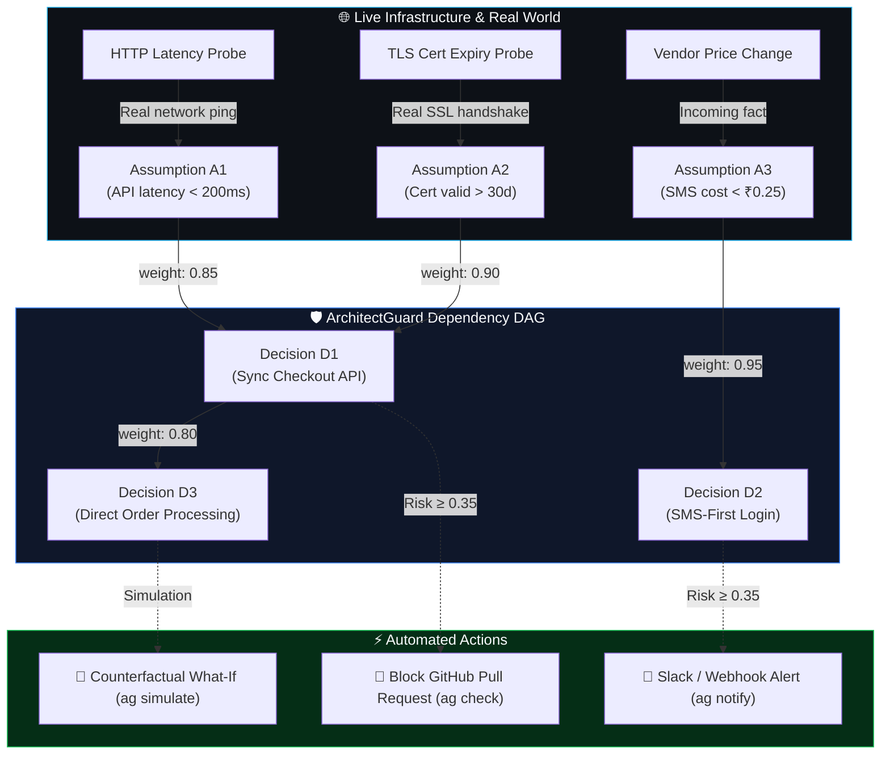

<div align="center">

# 🛡️ ArchitectGuard (`ag`)

### **The Active Architecture Decision Watchdog & Assumption Drift Monitor**

*Stop Architecture Decision Records (ADRs) from rotting silently when reality changes.*

---

[](https://www.python.org/)
[](https://opensource.org/licenses/MIT)
[](https://github.com/psf/black)
[](https://docs.pytest.org/)
[](https://fastapi.tiangolo.com)
[](http://makeapullrequest.com)

[**Quickstart**](#-quickstart-in-60-seconds) •
[**How It Works**](#-how-architectguard-works) •
[**Live Operational Probes**](#-live-operational-probes) •
[**CI/CD Integration**](#-cicd-pipeline-gate) •
[**CLI Reference**](#-cli-command-reference) •
[**REST API**](#-fastapi-backend)

</div>

---

## 📌 The Problem: Silent ADR Decay

Every engineering team writes **Architecture Decision Records (ADRs)**:
- *"We chose SMS OTP for authentication."*
- *"We chose direct synchronous writes to Postgres."*
- *"We chose Redis for all user sessions."*

**Architectural decisions don't fail because the code was bad. They fail because the underlying assumptions quietly changed in the real world:**

```
2022: SMS OTP costs ₹0.20/msg  ──► Decision D1 (SMS Login) works great.
2025: Vendor hikes price by 400% ──► Nobody updates ADR-001.
2026: Massive ₹500,000 billing spike & outage in production. 💥
```

Confluence and Markdown folders are **graveyards for architecture records**. They cannot calculate downstream blast radius, cannot run live network probes, and cannot block a pull request.

**ArchitectGuard turns static ADRs into living, automated watchdogs.**

---

## ⚡ Key Capabilities

| Feature | Description |
|---|---|
| **Directed Acyclic Graph (DAG)** | Models assumptions ($A$) and decisions ($D$) as a weighted graph using NetworkX. Zero cyclic deadlocks. |
| **Topological Risk Propagation** | Sweeps affected subgraphs in mathematical order using independent survival probability formulas. |
| **Live Reality Probes** | Connects assumptions to real HTTP latency, TLS certificate expiry, database TCP ports, and JSON APIs. |
| **Markdown ADR Ingestion** | Run `ag import-adr docs/adr/` to automatically parse existing Markdown decisions and extract premise statements. |
| **Counterfactual What-If Simulator** | Simulate candidate replacements in-memory to quantify blast radius reduction *before* refactoring code. |
| **CI/CD Pipeline Gate** | Run `ag check` in GitHub Actions to block PRs when underlying assumptions expire or cross risk thresholds. |
| **SQLite Persistence & CLI-First** | Native `ag` command line with rich formatting, backed by SQLite so state survives reboots. |
| **FastAPI REST Backend** | Microservice-ready HTTP API with automatic interactive OpenAPI / Swagger documentation. |

---

## 🔄 How ArchitectGuard Works



---

## 🚀 Quickstart in 60 Seconds

### 1. Installation

```bash
git clone https://github.com/Mohitgujjar07/ArchitectGuard.git
cd ArchitectGuard
pip install -e ".[all]"
```

Both `ag` and `architectguard` CLI commands are now registered in your shell.

---

### 2. Initialize Your Repository

In any project repository root:

```bash
ag init "Payment Gateway Microservice"
```
*(Creates `.architectguard/store.db` SQLite database and configuration).*

---

### 3. Record Assumptions & Decisions

```bash
# Record foundational premises
ag add assumption A1 "Postgres connection pool scales to 500 connections" \
  --category Technical \
  --valid-until 2026-12-31 \
  --owner "infra-team"

ag add assumption A2 "SMS gateway unit cost remains under 0.20 INR" \
  --category Financial \
  --valid-until 2025-10-01 \
  --owner "finance"

# Record architectural decisions
ag add decision D1 "Synchronous Order Checkout" "Process transactions immediately on thread" --criticality 0.9
ag add decision D2 "Mandatory SMS OTP on Login" "Verify identity strictly via SMS" --criticality 0.8

# Map directed dependencies
ag link A1 D1 --weight 0.85 --rationale "Fast DB required for sync checkout"
ag link A2 D2 --weight 0.90 --rationale "Low SMS cost justifies mandatory OTP"
```

---

### 4. Inspect Architecture Health

```bash
ag status
```

**Terminal Output:**
```text
┏━━━━━┳━━━━━━━━━━━━━━━━━━━━━━━━━━━━━━━━━━━━━━━━━┳━━━━━━━━━━━┳━━━━━━━━━━━━┳━━━━━━━━━━━━┳━━━━━━━━┓
┃ ID  ┃ Statement                               ┃ Category  ┃ Valid Until┃ Confidence ┃ Status ┃
┡━━━━━╇━━━━━━━━━━━━━━━━━━━━━━━━━━━━━━━━━━━━━━━━━╇━━━━━━━━━━━╇━━━━━━━━━━━━╇━━━━━━━━━━━━╇━━━━━━━━┩
│ A1  │ Postgres connection pool scales to 500  │ Technical │ 2026-12-31 │       1.00 │ VALID  │
│ A2  │ SMS gateway unit cost remains under 0.20│ Financial │ 2025-10-01 │       1.00 │ VALID  │
└─────┴─────────────────────────────────────────┴───────────┴────────────┴────────────┴────────┘
┏━━━━━┳━━━━━━━━━━━━━━━━━━━━━━━━━━━━━━┳━━━━━━━━━━━━━┳━━━━━━━━━━━━┳━━━━━━━━━━━━┓
┃ ID  ┃ Title                        ┃ Criticality ┃ Risk Score ┃ Status     ┃
┡━━━━━╇━━━━━━━━━━━━━━━━━━━━━━━━━━━━━━╇━━━━━━━━━━━━━╇━━━━━━━━━━━━╇━━━━━━━━━━━━┩
│ D1  │ Synchronous Order Checkout   │        0.90 │      0.000 │ VALID      │
│ D2  │ Mandatory SMS OTP on Login   │        0.80 │      0.000 │ VALID      │
└─────┴──────────────────────────────┴─────────────┴────────────┴────────────┘
System Blast Radius Score: 0.000
Broken Assumptions: 0 | At-Risk Decisions: 0/2
```

---

## 🔍 Live Operational Probes

Instead of sitting around waiting for humans to update spreadsheets, connect assumptions directly to **live operational probes**:

```bash
# 1. Live HTTP Latency Probe (fails if endpoint latency > 200ms)
ag attach-probe A1 --type http --url "https://api.mycompany.com/health" --max-latency 200

# 2. Live TLS/SSL Certificate Expiration Probe (fails if cert expires in < 30 days)
ag attach-probe A2 --type tls --host "auth.mycompany.com" --min-days 30

# 3. Live Database / Cache TCP Port Reachability Probe
ag attach-probe A3 --type socket --host "db.internal" --port 5432

# 4. Live JSON API Assertion Probe (verifies queue depth, cost, or RAM)
ag attach-probe A4 --type json_api --url "https://metrics.internal/stats" --field "memory_mb" --operator "<=" --threshold 512
```

### Run Live Watchdog Check:

```bash
ag probe
```

```text
🔍 Executing 4 live operational probes...

┏━━━━━┳━━━━━━━━━━┳━━━━━━━━━━┳━━━━━━━━━━━━━━━━━━━━━━┳━━━━━━━━━━━━━━━━━━━━━━━━━━━━━━━━━━━━━━━━━━┓
┃ ID  ┃ Probe    ┃ Result   ┃ Measured vs Limit    ┃ Message                                  ┃
┡━━━━━╇━━━━━━━━━━╇━━━━━━━━━━╇━━━━━━━━━━━━━━━━━━━━━━╇━━━━━━━━━━━━━━━━━━━━━━━━━━━━━━━━━━━━━━━━━━┩
│ A1  │ HTTP     │ PASS     │ 84.12ms (limit: 200) │ HTTP request OK: 200 in 84.12ms          │
│ A2  │ TLS      │ PASS     │ 88 days (limit: 30)  │ Certificate valid for 88 more days       │
│ A3  │ SOCKET   │ PASS     │ 4.21ms (limit: 500)  │ TCP port 5432 reachable in 4.21ms        │
│ A4  │ JSON_API │ PASS     │ 320 (limit: <= 512)  │ JSON field 'memory_mb' is 320            │
└─────┴──────────┴──────────┴━━━━━━━━━━━━━━━━━━━━━━┴━━━━━━━━━━━━━━━━━━━━━━━━━━━━━━━━━━━━━━━━━━┘
✓ All live operational probes passed. Reality conforms to architecture assumptions.
```

If a probe fails, **ArchitectGuard automatically trips the assumption in SQLite**, sweeps the DAG, and prints every downstream decision compromised in production!

---

## 📂 Import Existing Markdown ADRs

If your team already uses standard Architecture Decision Records (e.g. Nygard or MADR format):

```bash
ag import-adr docs/adr/
```

ArchitectGuard automatically:
1. Ingests Markdown files and extracts **Decision IDs, Titles, and Outcomes**.
2. Scans context paragraphs for premise cues (`cost`, `limit`, `under`, `budget`, `requires`, `SLA`, `uptime`).
3. Converts premise statements into **tracked Assumptions**.
4. Wires up **dependency edges** automatically!

---

## 🧪 Counterfactual "What-If" Simulator

Before spending weeks refactoring code, simulate candidate architecture replacements:

```bash
ag simulate \
  --break A2 \
  --replace D2 \
  --alt-title "Switch to Authenticator App TOTP & Biometrics" \
  --support A1 \
  --dep-weight 0.3
```

Calculates whether the alternative design reduces your system's overall blast radius score without touching your active production state.

---

## 🛡️ CI/CD Pipeline Gate

Add `ag check` to `.github/workflows/architecture-audit.yml`:

```yaml
name: Architecture Health Gate

on: [pull_request, push]

jobs:
  audit:
    runs-on: ubuntu-latest
    steps:
      - uses: actions/checkout@v4
      - uses: actions/setup-python@v5
        with:
          python-version: '3.11'
      - run: pip install .
      - run: ag check --fail-on-expired --fail-on-risk-above 0.5
```

**What happens on Pull Requests:**
If an engineer introduces a change depending on an **expired assumption**, or if cumulative risk crosses the threshold, **CI exits with code 1 and blocks the PR from merging**.

---

## 🌐 FastAPI Backend

Run the REST API for microservice integration:

```bash
uvicorn api.main:app --reload --port 8000
```

Interactive Swagger documentation is available at **`http://localhost:8000/docs`**:

| Method | Endpoint | Description |
|---|---|---|
| `GET` | `/health` | Service health status |
| `GET` | `/api/status` | Current graph health, blast radius, and all node statuses |
| `POST` | `/api/check` | Automated CI verification endpoint |
| `POST` | `/api/simulate` | Run counterfactual what-if simulation via HTTP |
| `POST` | `/api/assumptions` | Programmatically register new assumptions |
| `POST` | `/api/decisions` | Programmatically register new decisions |
| `POST` | `/api/dependencies` | Programmatically link dependency edges |

---

## 📊 Streamlit Interactive Dashboard

To launch the dark-mode command center:

```bash
streamlit run ui/app.py
```

Opens at **`http://localhost:8501`** featuring:
- Live NetworkX graph with real-time confidence sliders.
- Neuro-symbolic fact monitor that catches semantic contradictions in vendor news.
- Counterfactual replacement visualizer with blast radius comparisons.

---

## 🧮 Mathematical Foundations

Risk propagates across the Directed Acyclic Graph $G = (V, E)$ in topological order:

1. **Failure Transmission:**
   When assumption confidence degrades ($c \in [0.0, 1.0]$), failure transmitted across edge $(u, v)$ with weight $w_{uv}$ is:
   $$\text{transmitted\_risk}_{uv} = (1.0 - \text{validity}_u) \times w_{uv}$$

2. **Probabilistic Survival Combination:**
   For decisions with multiple parent dependencies, threats combine independently:
   $$\text{survival}_v = \prod_{u \in \text{Parents}(v)} (1.0 - \text{transmitted\_risk}_{uv})$$

3. **Criticality Scaling:**
   The raw threat $(1.0 - \text{survival}_v)$ is scaled by decision criticality $C_v \in [0.1, 1.0]$:
   $$\text{risk\_score}_v = (1.0 - \text{survival}_v) \times C_v$$

4. **Alert Threshold:**
   If $\text{risk\_score}_v \ge 0.35$, the decision node is flagged as **`AT_RISK`**.

---

## 💻 CLI Command Reference

```text
Usage: ag [OPTIONS] COMMAND [ARGS]...

  ArchitectGuard: Architectural decision watchdog and assumption drift monitor.

Commands:
  init          Initialize .architectguard/ repository and SQLite database
  add           Add assumptions or decisions to the project graph
  link          Create a directed dependency edge with weight and rationale
  attach-probe  Connect an assumption to a live HTTP, TLS, socket, or JSON probe
  probe         Run live operational probes and auto-trip graph on failure
  status        Display formatted summary table of all nodes and risk propagation
  check         Validate assumption health (ideal for CI gates)
  import-adr    Scan and parse Markdown ADR files into decisions & assumptions
  export        Export report to formatted Markdown or JSON
  simulate      Run counterfactual what-if replacement analysis
  notify        Dispatch formatted Slack/webhook alerts when risks trigger
  load-demo     Load the reference FinPay scenario for testing
```

---

## 🧪 Testing

ArchitectGuard includes a comprehensive test suite:

```bash
pytest
```

```text
tests/test_models.py .........                            [ 23%]
tests/test_graph_engine.py .....                          [ 36%]
tests/test_storage.py .....                               [ 50%]
tests/test_cli.py .....                                   [ 63%]
tests/test_parsers.py ..                                  [ 73%]
tests/test_notifications.py ...                           [ 84%]
tests/test_probes.py ......                               [100%]

======================== 38 passed in 1.42s ========================
```

---

## 📁 Repository Structure

```text
ArchitectGuard/
├── .github/
│   └── workflows/
│       └── assumption-check.yml   # Automated GitHub Action CI check
├── .streamlit/
│   └── config.toml                # Dark-mode dashboard theme
├── api/
│   ├── __init__.py
│   └── main.py                    # FastAPI REST backend & endpoints
├── cli/
│   ├── __init__.py
│   └── main.py                    # Typer & Rich terminal interface (`ag`)
├── core/
│   ├── __init__.py
│   ├── graph_engine.py            # NetworkX DAG & topological risk math
│   ├── logger.py                  # Standardized logging
│   ├── models.py                  # Pydantic v2 domain schemas
│   ├── notifications.py           # Slack Block Kit & webhook alerts
│   ├── storage.py                 # SQLite persistence layer
│   ├── validator.py               # Neuro-symbolic drift detector
│   ├── parsers/
│   │   ├── __init__.py
│   │   └── markdown_adr.py        # Markdown ADR auto-importer
│   └── probes/
│       ├── __init__.py
│       ├── base.py                # Base probe interface & result schema
│       ├── http_probe.py          # Real HTTP latency & TLS cert probes
│       ├── json_api_probe.py      # Real JSON API assertion probes
│       ├── registry.py            # Probe runner & auto-trip handler
│       └── socket_probe.py        # Real TCP port pings (DB/Cache)
├── data/
│   └── sample_scenario.json       # FinPay seed reference scenario
├── docs/
│   ├── DEMO_SCRIPT.md             # 5-minute presentation & demo script
│   └── adr/                       # Sample Architecture Decision Records
│       ├── 0001-use-postgresql.md
│       └── 0002-cache-in-redis.md
├── tests/                         # Pytest test suite (38 unit tests)
│   ├── conftest.py
│   ├── test_cli.py
│   ├── test_graph_engine.py
│   ├── test_models.py
│   ├── test_notifications.py
│   ├── test_parsers.py
│   ├── test_probes.py
│   └── test_storage.py
├── pyproject.toml                 # Packaging & dependencies
└── README.md
```

---

## 📄 License

This project is licensed under the **MIT License** — see the [LICENSE](LICENSE) file for details.

---

<div align="center">
Built with 🛡️ to keep software architectures resilient against real-world drift.
</div>
