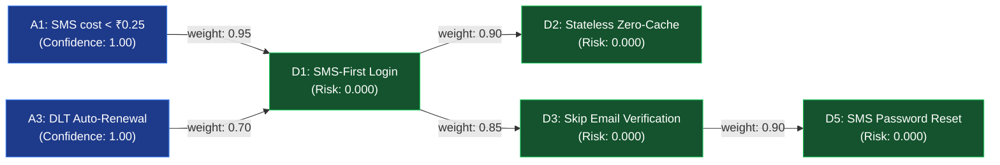
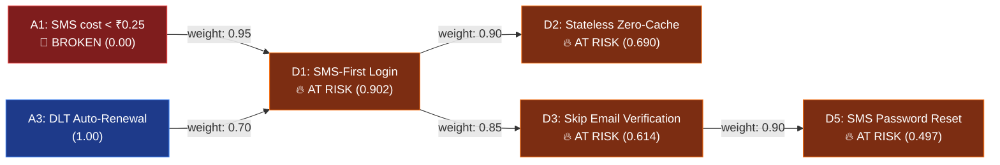

# 🛡️ ArchitectGuard — Live Interactive Experiment

Follow this **2-minute hands-on experiment** to see the watchdog catch an architecture failure in real time.

---

## 🧪 Experiment: The "Silent Telecom Decay" Disaster

We are going to simulate a real-world scenario where **1 single financial premise quietly fails**, and watch ArchitectGuard calculate the cascading failure across your architecture.

---

### Step 1: Launch the Visual Command Center

In your Command Prompt (`cmd.exe`), run:

```cmd
cd /d "C:\Users\MOHIT J GUJJAR\.gemini\antigravity\scratch\AssumptionPulse"
.venv\Scripts\activate.bat
streamlit run ui\app.py
```

Your browser will automatically open:
👉 **`http://localhost:8501`**

---

### Step 2: Look at the Clean Baseline Architecture

On **Tab 1 ("Dependency Graph & Impact")**, look at the baseline state:



- **Blue nodes** = Valid Assumptions ($A_i$)
- **Green nodes** = Safe Decisions ($D_j$)
- **Total System Blast Radius Score** = `0.000`

---

### Step 3: Trigger the Disaster (Break Assumption A1)

Now, simulate what happens when your telecom SMS vendor hikes rates by 400%:

1. On the right panel, select **`A1: SMS OTP gateway costs 0.25 INR...`**.
2. Drag the slider from **`1.00` down to `0.00`** *(Completely Broken)*.
3. Click **"Propagate Impact Across Graph"**.

---

### Step 4: SEE the Ripple Effect!

Look at how the graph updates in real time:



Notice what happened:
1. Node **`A1`** turns **RED** (Broken).
2. Node **`D1`** turns **ORANGE** (`risk_score: 0.902` — Critical).
3. The failure cascades down:
   - **`D2`** turns **ORANGE** (`risk_score: 0.690`) because zero-caching forces an expensive SMS on every login.
   - **`D3`** turns **ORANGE** (`risk_score: 0.614`) because skipping emails means you have no backup login channel.
   - **`D5`** turns **ORANGE** (`risk_score: 0.497`) because password recovery is trapped using SMS.
4. **Total System Blast Radius Score explodes from `0.000` to `2.703`!**

---

### Step 5: Test the AI Neuro-Symbolic Drift Detector

Now click on **Tab 2 ("Hybrid Fact & Expiry Monitor")**:

1. In the text box, paste this real-world news:
   > *"Telecom regulatory authority has banned all unregistered DLT SMS templates effective immediately"*
2. Click **"Analyze & Auto-Propagate"**.

**What happens:**
The local embedding model scans the statement, detects the contradiction keyword `banned`, matches it against **`A3 (Telecom DLT approval)`**, flags a `SEMANTIC_CONTRADICTION`, and trips the graph automatically!

---

### Step 6: Fix It with the Counterfactual Simulator

Now click on **Tab 3 ("What-If Decision Simulator")**:

1. Target Broken Assumption: **`A1`**
2. Decision to Replace: **`D1 (Primary Login via SMS OTP)`**
3. Alternative Title: *"Switch Primary Login to Email OTP + 30-Day Session Tokens"*
4. Click **"Run Counterfactual Simulation"**.

**What you SEE:**
- **Balloons fly across your screen! 🎈**
- The System Blast Radius drops from **`2.703` down to `0.35`**.
- It shows you that this alternative decision safely resolves all 4 compromised systems!

---

## ⚡ Try the Live Reality Probes in Terminal

Open a second CMD window and see live network probes talk to real websites:

```cmd
cd /d "C:\Users\MOHIT J GUJJAR\.gemini\antigravity\scratch\AssumptionPulse"
.venv\Scripts\activate.bat

# Attach a real probe to Google's TLS certificate:
ag attach-probe A2 --type tls --host "google.com" --min-days 30

# Attach a real probe to GitHub's API latency:
ag attach-probe A1 --type http --url "https://api.github.com" --max-latency 1000

# Run the live watchdog:
ag probe
```

You will see real millisecond measurements and SSL certificate expiration dates verified against your assumptions right in the terminal!
